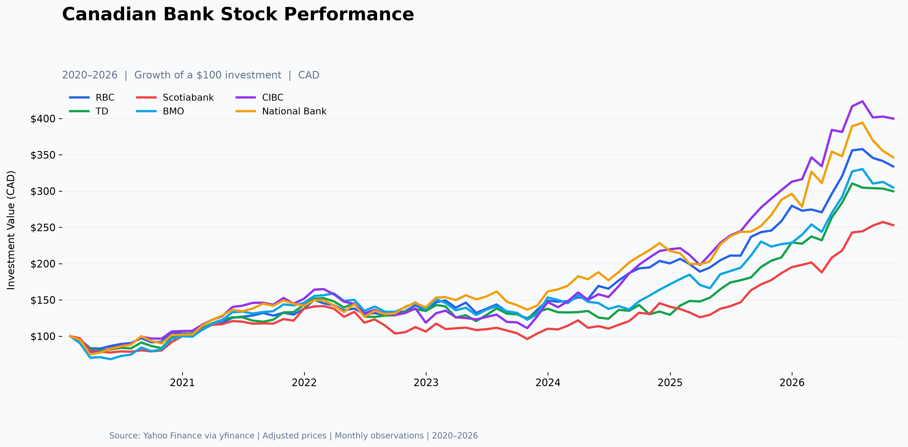

# Canadian Banking Financial Data Pipeline

A Python-based financial data analysis project that retrieves, processes, and visualizes historical stock market data for Canada's six major banks.

The project demonstrates financial data extraction, ETL (Extract, Transform, Load) concepts, time-series data processing, and comparative stock performance analysis using Python.

## Project Overview

This project explores how Python can automate the collection and analysis of financial market data.

Using Yahoo Finance through the `yfinance` library, the application retrieves historical stock prices for six major Canadian banks, transforms daily observations into monthly datasets, calculates financial returns, and generates comparative performance visualizations.

The analysis covers historical market data from January 2020 through October 2026, subject to data availability.

## Key Features

- **Financial Data Extraction:** Retrieve historical stock market data using `yfinance`.
- **Data Processing:** Organize and transform financial datasets using Pandas and NumPy.
- **Time-Series Analysis:** Convert daily stock prices into monthly observations.
- **Return Calculation:** Calculate monthly percentage returns for each bank.
- **Performance Normalization:** Normalize stock prices to a common starting value of 100.
- **Comparative Analysis:** Evaluate historical stock performance across Canadian financial institutions.
- **Data Visualization:** Generate comparative stock performance charts using Matplotlib.
- **Workflow Automation:** Combine financial data retrieval, transformation, analysis, and visualization into a repeatable Python workflow.

## Canadian Banks Analyzed

| Bank | Stock Ticker |
|---|---|
| Royal Bank of Canada (RBC) | RY.TO |
| Toronto-Dominion Bank (TD) | TD.TO |
| Bank of Nova Scotia (Scotiabank) | BNS.TO |
| Bank of Montreal (BMO) | BMO.TO |
| Canadian Imperial Bank of Commerce (CIBC) | CM.TO |
| National Bank of Canada | NA.TO |

**Data Source:** Yahoo Finance (`yfinance`)

**Analysis Period:** January 2020 – October 2026

## Technologies Used

| Technology | Purpose |
|---|---|
| Python | Application development and workflow automation |
| Pandas | Financial data processing and transformation |
| NumPy | Numerical computations |
| yfinance | Historical financial market data retrieval |
| Matplotlib | Data visualization |

## Project Structure

```text
Canadian-Banking-Financial-Data-Pipeline/
├── bank_analysis.py
├── outputs/
│   └── bank_performance.png
├── README.md
└── .gitignore
```

The structure above represents the banking-only version of the project. File and directory names should match the actual repository.

## Installation

### 1. Clone the Repository

```bash
git clone https://github.com/cowboytrex/ESG-Investment-Analysis.git
cd ESG-Investment-Analysis
```

The commands above use the existing GitHub repository URL. Update them if you rename the repository.

### 2. Create a Virtual Environment

**macOS / Linux**

```bash
python3 -m venv .venv
source .venv/bin/activate
```

**Windows**

```powershell
python -m venv .venv
.venv\Scripts\activate
```

### 3. Install Dependencies

```bash
python -m pip install --upgrade pip
python -m pip install pandas numpy matplotlib yfinance
```

## How to Run

Run the financial analysis script:

```bash
python bank_analysis.py
```

The workflow:

1. Retrieves historical market data for six Canadian banks.
2. Extracts and organizes historical stock-price observations.
3. Transforms daily data into monthly time-series observations.
4. Calculates monthly percentage returns.
5. Normalizes stock prices for comparative analysis.
6. Generates a financial performance visualization.

The expected chart output is:

```text
outputs/bank_performance.png
```

## Stock Performance Visualization



The visualization compares historical stock performance across six Canadian banks.

Stock prices are normalized to a starting value of 100, allowing relative performance comparisons regardless of differences in initial share prices.

A normalized value of 150 represents a 50% increase relative to the starting observation.

## Data Pipeline Architecture

```text
Yahoo Finance
      |
      v
Data Extraction (yfinance)
      |
      v
Data Processing (Pandas / NumPy)
      |
      v
Monthly Time-Series Transformation
      |
      v
Financial Return Calculations
      |
      v
Stock Performance Comparison
      |
      v
Visualization (Matplotlib)
```

### 1. Data Extraction

Retrieve historical daily market data for six Canadian banks through Yahoo Finance.

### 2. Data Transformation

Process historical observations and aggregate daily stock prices into monthly data.

### 3. Financial Analysis

Calculate monthly returns and normalize stock prices to evaluate relative historical performance.

### 4. Data Visualization

Generate comparative charts illustrating stock performance over the selected period.

## Financial Calculations

### Normalized Stock Performance

Normalized Price = (Current Adjusted Price / Initial Adjusted Price) × 100

### Monthly Percentage Return

Monthly Return = (Current Month Price / Previous Month Price) − 1

These metrics provide a consistent framework for comparing historical stock performance across different financial institutions.

## Technical Skills Demonstrated

- Python programming and financial data analysis
- Data extraction using third-party Python libraries
- ETL workflow concepts
- Data cleaning and transformation
- Time-series data processing
- Numerical analysis using Pandas and NumPy
- Financial data visualization
- Reproducible analytical workflows

## Limitations

- The analysis focuses on historical stock market data and does not predict future stock prices.
- Historical returns do not guarantee future investment performance.
- Data quality and availability depend on Yahoo Finance.
- The current workflow does not include persistent SQL database storage.
- The analysis focuses on historical price performance rather than comprehensive financial statement analysis.

## Future Improvements

- **SQL Database Integration:** Store processed financial data using PostgreSQL or MySQL.
- **REST API Development:** Build a FastAPI service to expose historical financial datasets.
- **Automated ETL Scheduling:** Implement scheduled financial data collection and processing.
- **Data Validation:** Add automated checks for missing values, duplicates, and inconsistent observations.
- **Risk Analysis:** Calculate volatility, Sharpe ratios, and maximum drawdowns.
- **Interactive Dashboard:** Develop an interactive dashboard using Streamlit or React.
- **Automated Testing:** Add unit tests for financial calculations and data transformation.

## Disclaimer

This project is intended for educational, research, and portfolio demonstration purposes only.

The analyses and visualizations do not constitute financial or investment advice.
